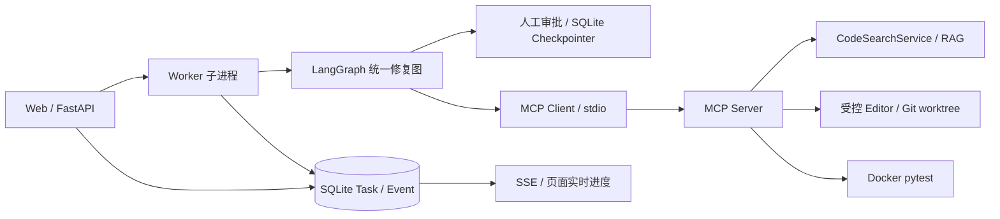

# AICodingDoctor V1–V4 精简重构记录

> 类型：**保守型代码瘦身**；不是 V5 新功能开发，也不是 Bug 修复。
>
> 基线：用户上传的 `codingDoctor2_v4.zip`；目标：**只保留最新 V4 Web 产品的运行主链路及必要的回归测试**。
>
> 注意：下面的“保留”表示源码及调用路径得到保留，**不表示本次已经实机验收全部能力**。

## 1. 重构前的问题

原项目以 V1→V2→V3→V4 逐步增加功能，正式产品已经是 V4 Web 工作台，但项目根目录仍有：

- V1 交互控制台 `main.py`（同时承担大量演示、Benchmark、实验代码），`agent/` 的旧 `CodeAgent` 与 Middleware；旧单轮 `rag/rag_chain.py`、`rag/retriever.py`。
- V2 的 `graph/cli.py`，V3 的 `v3_runtime/cli.py`，大量重复的启动和环境组装逻辑。
- `graph/workflow.py` 与 `web_runtime/workflow.py` 分别声明完整的 Graph 拓扑；V4 版本额外接入审批节点，同一处路由规则需要分别维护。
- 空的 `memory/memory_store.py`，早期版本 Prompt、Demo 和混杂的架构文档。
- `config.py` 同时配置旧 V1 Agent Middleware 和现有 V4 检索、模型，难以看出正式主链路实际依赖什么。

**关键边界**：V1 `CodeAgent` 并未被 V4 Worker 的只读问答调用；V4 `ask` 是 `search_code + model.invoke`。本次移除旧 Agent 不会改变 V4 原有问答行为，但也**不会带来 V1 的多轮问答能力**。

## 2. 本次已经完成的修改

### 2.1 删除不再参与 V4 主链路的实现

| 操作 | 源文件/目录 | 说明 |
| --- | --- | --- |
| 删除 | `agent/` | 旧 V1 Console Agent、Middleware、上下文去重、Tool 包装；V4 Worker 从未调用 |
| 删除 | `rag/rag_chain.py`、`rag/retriever.py` | 旧单轮 Chain 与其薄 Retriever；保留 V4 实际使用的混合检索与 Chroma |
| 删除 | `memory/` | 原目录中的空文件，不包含真正 Checkpointer；V4 SQLite Checkpointer 保留 |
| 删除 | `run_demo.py`、`run_demo_v2.py` | 旧演示入口，不属于 V4 |
| 删除 | `graph/cli.py`、`v3_runtime/` | 旧 V2/V3 CLI；不再维护多套运行器 |
| 删除 | `utils/agent_observability.py`、`utils/token_tracker.py` | 仅由旧 V1 Agent 使用；保留 V4 `RepairNodes` 原有 Token 统计、审计和事件 |
| 删除 | 根目录 V1/V2 Prompt/总结、`v3plan.txt` | 历史计划不混放于运行入口 |
| 保留 | `graph/demo.py` | 仍被离线 V2/V3/V4 Graph 回归使用的模拟模型/Fixture，不参与生产 Web 调用 |

对应只测试旧入口的测试模块一起移除：

`test_agent_middleware_wiring.py`、`test_agent_observability.py`、`test_agent_prompts.py`、`test_tool_result_dedup.py`、`test_real_token_benchmark.py`、`test_run_demo.py`、`test_v2_integration.py`、`tests/v3/test_runtime.py`。

保留的回归测试中，只清理了两个失效的旧入口用例：

- `test_code_search_service.py` 删除对已移除 `CodeAgent` 的兼容性测试；其余增量索引、仓库绑定、异常一致性测试保留。
- `test_hybrid_retriever.py` 删除旧 LangChain Tool artifact 专属测试；**Dense/BM25/RRF/Rerank 的核心检索测试保留**。
- `tests/v3/test_docker.py` 删除依赖旧 V3 CLI 的真实整链测试；容器隔离、安全配置、回收测试保留。

### 2.2 统一 Graph 构建位置（本次最重要的架构合并）

原来：

```text
V2: graph/workflow.py       ── 独立创建 StateGraph（不审批）
V4: web_runtime/workflow.py ── 独立创建 StateGraph（带审批）
```

现在：

```text
 graph/workflow.py
    └── build_repair_graph(nodes, saver=None, require_approval=True)
         ├── True : Planner → PlanApproval → EditApproval
         │          → Coder → TestApproval → Tester → Reviewer
         │          → 重试/Finalizer
         └── False: Planner → Coder → Tester → Reviewer
                    → 重试/Finalizer（供既有离线回归测试）

 web_runtime/workflow.py
    └── build_graph(nodes, saver)  # 仅调用共享工厂，V4 审批默认启用

 graph/workflow.py::RepairWorkflow
    └── V2 离线测试兼容外观，调用同一共享工厂，不再复制连接边
```

保持不变的 V4 语义：

- 计划拒绝且带反馈，返回 Planner 重规划；无反馈则阻塞结束。
- 轮次变更需重新经过 `EditApproval`；补丁被拒绝交给 Reviewer 判断是否重试。
- Tester 执行前需要 `TestApproval`；`interrupt` / `Command` 持久审批点不变。
- 正式 V4 的 SQLite Checkpointer、Graph `thread_id` 和 `stream(..., stream_mode="updates")` 调用路径不变。

这里只合并**拓扑定义**，没有改变 Coder/Editor 逻辑，没有实施“补丁生成 → Diff 预览 → 审批 → 应用”的新流程；该设计留在待办中。

### 2.3 精简启动入口、配置及文档

- `main.py` 从混合型控制台、演示和 Benchmark 脚本改为最小 Web 启动器：`python main.py`，默认绑定 `127.0.0.1:8000` 且只启动一个 Uvicorn worker。
- `config.py` 仅保留 V4 实际读取的索引、Embedding、Rerank、LLM 和日志配置；删除旧 Console Agent 的 Middleware 上限配置。
- `requirements.txt` 删除对顶层 `langchain` 包的**显式**依赖；保留实际用到的 `langchain-core`、`langchain-classic`、`langgraph`、`mcp` 等（依赖解析仍可能间接安装 `langchain`）。
- 更新 `.gitignore`；新增根目录 `README.md` 与本重构文档；`AGENTS.md` 改成 V4 的短版代码约束。
- V1/V2/V3 及早期架构资料移动至 `docs/history/`，以免被误读为当前架构。

## 3. 重构后主链路（保留的 V4 能力）



**继续保留**：仓库选取、受控文件白名单、工作树创建、只读问答、AST-first 切分、增量索引、BM25+Dense+RRF+Rerank、规划/修改/测试人工审批、自动修复循环、审计、Diff、确认应用、SSE、SQLite 任务与 Graph 持久化。

**明确没有新增**：多轮 V1 CodeAgent 整合、Agent 多语言解析、Redis/Celery、在线协作、自动 Docker 镜像构建、真实 Patch Diff 审批。

## 4. 本次刻意没有修复的问题（后续迭代清单）

| 优先级 | 待解决问题 | 原因与建议的后续方向 |
| --- | --- | --- |
| P0 | 页面 API Key 未完整传递至 MCP Embedding/Rerank 进程 | `mcp_client/client.py` 的环境白名单只包含 `DASHSCOPE_API_KEY`；需配置分域凭据并安全传递 |
| P0 | SQLite 状态无条件写入存在覆盖竞态 | `Store.update()` 与 Worker `running` 更新可能覆盖 `cancelling`；后续引入合法状态迁移、事务 CAS |
| P1 | 只读 `ask` 仍先创建 worktree 和 DockerRunner | `web_runtime/worker.py` 复用修复任务初始化；应拆成轻量问答与修复两条初始化路径 |
| P1 | V4 只读问答不是 V1 多轮 Agent | 目前固定检索若干证据 + `model.invoke`；未来再设计 `CodeQAService`，可根据需求引入多轮对话 |
| P1 | MCP 初始化/审批恢复重新建立连接并检查索引 | `mcp_servers/context.py` 每次创建上下文会同步索引；考虑按仓库版本复用索引及 dirty layer |
| P1 | `RepairNodes` 的 token/event 信息保留在节点实例内 | 跨 Worker 恢复时完整累计可能丢失；统一任务级持久聚合 |
| P1 | Planner 只补读前三个文件，源码候选上限偏小 | `graph/nodes.py` 的 `candidates[:3]`；后续基于 BM25、符号、Dense 的实际命中按需读取 |
| P1 | 修改前审批无法看到真正的 Patch | 目前只审批目标文件；未来拆分 Coder 生成补丁、PatchValidator 和 Editor 执行 |
| P1 | 任务强制取消、崩溃恢复与外部副作用幂等 | 应独立记录 operation_id、补丁哈希、执行状态，恢复前先对账 |
| P2 | SSE 事件重复保存过多业务数据、日志增长 | 后续分离小型事件及大型 Artifact，并增加留存清理策略 |
| P2 | 工作树中的源码与 RAG 索引一致性 | 检索快照应能识别 stale，实时源码为真实依据 |
| P2 | 完整 V4 集成验收未覆盖所有真实环境组合 | 增加真实 API、MCP、Docker、Git worktree 与浏览器端到端测试 |
| P2 | 仅支持 `.py` / `.md` | 多语言支持属于未来需求，不在本轮优化范围 |

以上清单是**遗留问题**，不是声称本次已修复。当前 V4 的安全边界是单机、用户明确授权的本地 Git 仓库；不应直接按生产多租户 SaaS 部署。

## 5. 验证方法、限制与回归重点

本包在生成环境对所有保留 `.py` 执行了标准库 `compileall` 语法检查，并检查移除模块的显式 import 引用。实际验证结果：

| 检查 | 结果 |
| --- | --- |
| `python -m compileall -q .` | **通过**：68 个 Python 源文件（增加冒烟测试前），最终打包重新检查 |
| `pytest tests/test_v4_smoke.py tests/test_v4_diagnostics.py -q` | **7 passed**，Web 本机访问边界和启动入口已覆盖 |
| `pytest tests/test_v4_runtime.py -q` | **无法收集**：当前运行环境缺少 `langgraph`（`ModuleNotFoundError`），并非测试断言失败 |
| V4 真实模型 + MCP + Docker 端到端 | **未执行**：缺少项目完整依赖、可用密钥及本地 Docker 测试镜像 |

源文件数量从 **92 → 69**（含新增冒烟测试），总 Python 行数约减少四分之一；属于清理旧运行路径后的规模变化，不能直接当作性能改善。

推荐本机执行：

```powershell
python -m compileall -q .
python -m pytest tests/test_v4_runtime.py tests/test_v4_diagnostics.py -q -p no:cacheprovider
python -m pytest tests/test_v2_workflow.py tests/v3/test_web_workflow.py -q -p no:cacheprovider
python -m pytest tests -q -p no:cacheprovider
```

重点人工验收：

1. 浏览器本机启动、选择仓库、提交只读问答、SSE 获得任务终态。
2. 修复模式的计划审批、拒绝/重规划、修改审批、测试审批、Reviewer 重试路径。
3. 关闭并重启服务后，审批点恢复的 `thread_id`、Checkpoint、任务状态和 Diff 是否一致。
4. MCP 搜索、文件写入审计、Git worktree、Docker 固定 pytest、最终报告和应用原仓库是否仍工作。
5. 取消正在执行的任务，重复提交审批与应用，检查是否发生重复副作用（这些属于已知风险测试，测试失败需要单独修复）。

**不可把 `compileall` 或 mock-only 单测通过解读为真实 MCP + Docker + LLM 完整验收**。原包中的 `.git` 历史、Windows `%SystemDrive%` 缓存、`.pyc`/日志/数据库没有包含在精简发布包内；这不会影响运行源码，但精简包也不携带旧 Git 提交历史。

## 6. 后续建议推进顺序

- **R1：可靠性补丁**：凭据转交、任务状态机、取消/恢复幂等。
- **R2：运行时进一步解耦**：问答独立初始化、统一 Token/事件持久化。
- **R3：检索与编辑流程**：索引复用、Planner 精准检索、Patch Diff 审批。
- **R4：完整集成验收**：真实模型、MCP/Docker、浏览器跨重启的端到端测试。

建议每个阶段独立 Git 提交，并以 V4 Web 的行为回归为准，避免把旧代码清理和功能变化一次性混在同一提交中。
