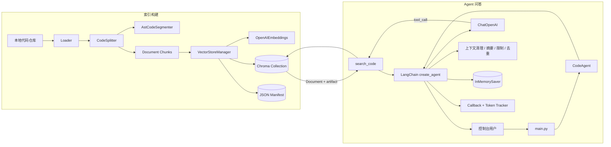
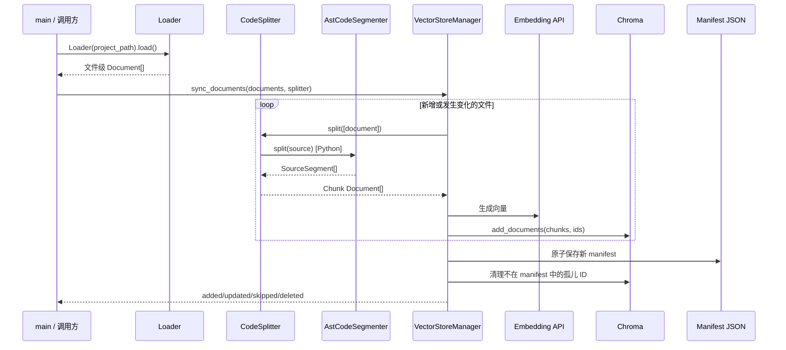
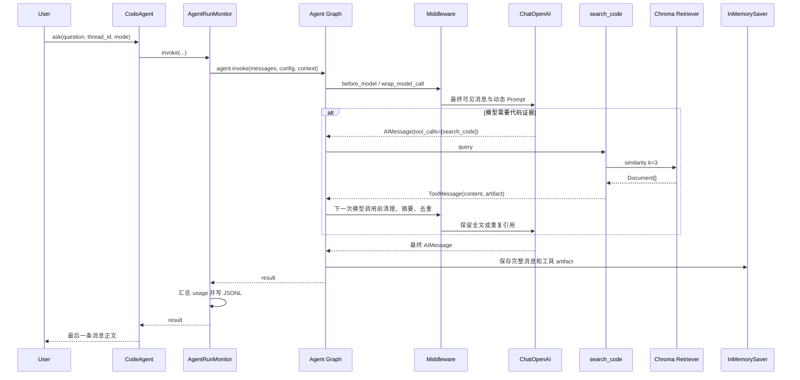

# AICodingDoctor 架构说明

本文基于当前仓库源码整理，描述目录职责、公开接口、运行入口和主要调用关系。
当前主实现是一个面向本地 Python/Markdown 仓库的控制台代码分析 Agent：源码先被切分并写入 Chroma，Agent 再通过 `search_code` 工具检索证据并回答问题。

## 1. 系统边界与技术栈

AICodingDoctor 当前负责：

- 扫描本地目录中的 `.py` 和 `.md` 文件；
- 使用 AST-first 策略切分 Python 源码并补充符号、行号和字符偏移；
- 使用 DashScope OpenAI 兼容 Embedding 接口生成向量，持久化到本地 Chroma；
- 使用 LangChain 1.x Agent 自主调用代码检索工具；
- 通过 LangGraph `InMemorySaver` 保存进程内多轮消息；
- 清理、摘要长上下文，限制模型和工具调用次数，并压缩发送给模型的重复 Chunk；
- 记录运行日志以及服务端返回的 LLM Token 用量。

核心依赖是 `langchain`、`langchain-core`、`langgraph`、`langchain-openai`、`langchain-chroma`、`langchain-community`、`langchain-text-splitters` 和 `python-dotenv`。模型与 Embedding 都使用 DashScope 的 OpenAI 兼容端点。

当前不包含 Web/API 服务、GitHub 集成、代码修改执行、持久化会话数据库或生产级多进程索引协调。

## 2. 目录与模块职责

| 路径 | 职责 | 状态 |
| --- | --- | --- |
| `main.py` | 控制台入口、索引演示、旧 RAG 演示、真实 Token A/B 测试 | 当前入口 |
| `config.py` | Chroma、模型、日志、中间件阈值和调用上限 | 全局配置 |
| `agent/` | 多轮工具 Agent、Prompt、Middleware、工具格式及上下文去重 | 当前问答主路径 |
| `rag/loader.py` | 扫描代码仓库并生成文件级 `Document` | 索引入口 |
| `rag/splitter/` | AST-first 分段、二次文本切分和兼容标签 | 索引处理 |
| `rag/vector_store.py` | Embedding、Chroma、索引清单、增量同步和相似度检索 | 存储核心 |
| `rag/retriever.py` | 对 `similarity_search()` 的轻量封装 | 旧单轮路径 |
| `rag/rag_chain.py` | 固定检索一次、固定 Prompt 回答的单轮 RAG | 兼容/演示路径 |
| `utils/logger.py` | `AICodingdoctor.*` Logger 的控制台和文件 Handler | 基础设施 |
| `utils/agent_observability.py` | Agent Callback、每轮用量汇总及统一 invoke | 当前观测层 |
| `utils/token_tracker.py` | 将 LLM 用量追加到 JSONL 并汇总历史数据 | 用量持久化 |
| `memory/memory_store.py` | 当前为空；没有参与调用 | 预留目录 |
| `data/` | Chroma、Collection manifest、`token_usage.jsonl` | 本地运行数据 |
| `logs/` | `AICodingDoctor.log` 和真实 Token 对比报告 | 本地运行数据 |
| `tests/` | AST、Agent、Middleware、观测和 Benchmark 的 pytest 测试 | 验证代码 |
| `docs/` | 版本设计、切分器、Middleware 和上下文去重说明 | 项目文档 |

## 3. 总体组件关系



索引构建与问答是两条独立链路。问答不会自动加载或同步源码；使用 Agent 前，目标仓库必须已经同步到配置的 Chroma Collection。

## 4. 运行入口

### 4.1 默认控制台 Agent

执行：

```powershell
python main.py
```

`main.py` 默认调用 `my_test_agent()`：

1. 加载 `.env` 并初始化日志；
2. 创建 `VectorStoreManager`，连接已有 Collection；
3. 创建 `CodeAgent`；
4. 生成新的 `thread_id`，进入交互循环；
5. 普通输入交给 `CodeAgent.ask()`；
6. `new` 创建新会话，`history` 读取 Checkpoint，`mode normal/debug/review` 切换运行时 Prompt；
7. `quit`、`exit`、`q` 在本地退出，不调用模型。

### 4.2 真实 Token A/B 测试

执行：

```powershell
python main.py --token-benchmark
```

`my_test_agent_token_savings()` 对五个固定问题分别运行 baseline 和 Chunk 去重版本。两组使用独立 Agent 图、Checkpointer 和 thread，记录服务端 Token、模型调用次数、工具执行次数及工具内容字符数，结果写入 `logs/token-comparison-<uuid>.json`。

该测试会调用真实 LLM 与查询 Embedding，但不会清空或重建 Chroma。由于两组模型可能选择不同的检索词和调用次数，结果属于端到端观察，不能单独归因于去重算法。

### 4.3 索引和旧 RAG 演示入口

`main.py` 还保留三个非默认函数：

- `my_test_vector_store()`：加载硬编码的示例仓库、创建切分器、同步索引并做一次查询。函数中包含 `manager.clear_all()`，手动启用前应确认确实要重建当前 Collection。
- `my_test_rag_chain()`：通过 `CodeRetriever + RAGChain` 执行一次固定检索、一次模型回答。
- `my_test_logger()`：验证日志级别和子 Logger。

这些函数没有接入命令行参数，当前需要手动调用或修改入口。

## 5. 索引构建链路



### 5.1 Loader

`Loader(directory)` 递归读取目录，只支持 `.py`、`.md`，忽略 `.git`、虚拟环境、`node_modules`、IDE、缓存及构建目录。

公开接口：

```python
Loader(directory: str)
Loader.load() -> list[Document]
Loader.failed_files: list[str]
```

Python 使用 `PythonLoader`，Markdown 使用 UTF-8 `TextLoader`。每个文件级 Document 包含：

| metadata | 含义 |
| --- | --- |
| `source` | 绝对文件路径 |
| `file_name` | 文件名 |
| `relative_path` | 相对扫描根目录的 POSIX 路径 |
| `file_type` | 小写扩展名 |
| `start_line` / `end_line` | 文件级起止行号 |

空文件跳过；单文件异常写入 `failed_files`，其余文件继续加载。调用方只有在确认扫描完整时才应允许删除缺失文件的旧索引。

### 5.2 AST-first Splitter

`CodeSplitter` 是统一切分入口：

```python
CodeSplitter(chunk_size: int = 1000, chunk_overlap: int = 150)
CodeSplitter.split(documents: list[Document]) -> list[Document]
```

Python 路径：

1. `AstCodeSegmenter.split(source)` 使用标准库 `ast` 识别模块函数、异步函数、类、方法及嵌套类；
2. 装饰器和同缩进的前置说明注释归入对应声明；许可证、编码、shebang 和工具指令注释受到保护；
3. 函数内部的嵌套函数/局部类保留在外层函数中，避免重复索引；
4. 纯注释/空白 AST 段通过 `has_python_code()` 过滤；
5. 小于阈值的 AST 段保持完整，超长段交给 `PythonCodeTextSplitter` 二次切分；
6. AST 解析或边界校验失败时回退普通 Python splitter，再由 `AstTagger` 补充符号标签。

Markdown 使用 `MarkdownTextSplitter`。其他后缀有通用 splitter 分支，但 Loader 当前不会加载它们。

输出 Chunk 在文件级 metadata 基础上增加：

| metadata | 含义 |
| --- | --- |
| `chunk_index` | 文件内连续序号 |
| `start_index` / `end_index` | 原文件中的左闭右开字符范围 |
| `start_line` / `end_line` | 首尾有效字符所在行，闭区间 |
| `module_path` | 从相对路径得到的 Python 模块路径 |
| `symbol_name` / `qualified_name` | 主符号及限定名 |
| `symbol_type` | `module`、`class`、`function`、`method` 或兼容默认值 |
| `parent_class` | 方法/嵌套类所属类 |
| `symbol_names` | JSON 字符串，便于 Chroma metadata 保存和工具模板显示 |
| `ast_segment_index/type` | 一级 AST 段信息 |
| `ast_part_index/count` | 超长段二次切分信息 |

`SourceSegment` 使用原始源码字符偏移，一级段不重叠；二次切分允许配置的 overlap。

### 5.3 VectorStoreManager

`VectorStoreManager` 同时管理 Embedding 客户端、Chroma Collection 和每 Collection 一份的 JSON manifest。

主要公开接口：

```python
VectorStoreManager(persist_directory=..., collection_name=...)
sync_documents(documents, splitter, remove_missing=False) -> dict[str, int]
similarity_search(query, k=5, filter=None) -> list[Document]
clear_all() -> bool  # 破坏性管理接口；实现当前没有显式返回值
```

增量同步以文件为单位：

- 文件内容 SHA256 和索引配置签名均未变化时跳过；
- 签名包含 Embedding 配置、splitter 类型、尺寸、overlap 和 `splitter_version=5`；
- Chunk ID 由相对路径、文件哈希、签名和文件内 Chunk 序号计算；
- 新向量全部写入后才原子替换 manifest，再清理旧版本及中断遗留的孤儿向量；
- 写入失败时尝试删除本轮 staged ID，不提前删除旧索引；
- `remove_missing=True` 仅应在完整扫描成功后使用；
- 当前设计要求一个 Collection 对应一个项目，且只允许一个进程更新索引。

持久化位置由 `VECTOR_STORE_PATH` 控制；默认 Collection 是 `AI_JueJin_ASTFirst`。初始化需要 `DASHSCOPE_API_KEY`，即使只连接已有 Chroma，也会创建 Embedding 客户端。

## 6. Agent 问答主链路



### 6.1 CodeAgent

`CodeAgent(vector_manager)` 是主路径的外观类。初始化时：

- 创建 `ChatOpenAI`；
- 调用 `create_code_tools()` 创建检索工具；
- 创建进程内 `InMemorySaver`；
- 通过 `create_agent()` 组装模型、工具、Middleware、运行时 Context 和 Checkpointer；
- 创建 `AgentRunMonitor`。

公开接口：

```python
CodeAgent.ask(question, thread_id="default", mode="normal") -> str
CodeAgent.new_thread_id() -> str
CodeAgent.get_history(thread_id) -> list[BaseMessage]
```

`mode` 可为 `normal`、`debug`、`review`。它通过 `AgentContext` 作为单次运行时依赖传入，不写入消息历史。会话只在当前进程存活，程序重启后丢失。

### 6.2 search_code 工具

`create_code_tools(vector_manager)` 使用官方 `create_retriever_tool()`：

- Retriever 来自 `vector_manager.vector_store.as_retriever()`；
- 搜索类型为 similarity，固定 `k=3`；
- 工具名为 `search_code`；
- `response_format="content_and_artifact"`，ToolMessage 同时包含格式化文本和原始 `Document[]`；
- Document 格式由 `agent/tool_documents.py` 的 `DOCUMENT_PROMPT` 和 `DOCUMENT_SEPARATOR` 统一定义。

每个结果向模型展示相对路径、模块、限定符号、符号类型、关联符号、行号和源码。artifact 供 Chunk 去重可靠识别，不改变 Retriever 或 ToolNode 的执行方式。

### 6.3 Prompt 与 Middleware

`build_system_prompt(mode)` 合并公共规则、模式规则和工具限制说明。`task_prompt` 使用官方 `@dynamic_prompt` 在每次模型调用前读取 `AgentContext.mode`。

`build_middlewares(llm)` 当前组装：

1. `ContextEditingMiddleware`：输入估算超过阈值后，将较老 ToolMessage 替换为占位符，保留最近配置数量；
2. `SummarizationMiddleware`：历史仍然过长时调用模型摘要较早消息；
3. `ModelCallLimitMiddleware`：限制一次运行中的 Agent 模型调用；
4. `ToolCallLimitMiddleware`：限制 `search_code` 调用；
5. 动态 Prompt；
6. `ChunkDedupMiddleware`。

列表顺序不等于所有 Hook 的运行阶段。摘要通过 `before_model` 先更新 Agent state；ContextEditing 在 `wrap_model_call` 中编辑当前模型请求的副本；Chunk 去重位于包装链内侧，因此读取的是摘要、清理后最终仍对模型可见的消息。

### 6.4 Chunk 结果去重

`ChunkDedupMiddleware` 只优化模型请求，不修改工具执行和 Checkpoint：

- 每次模型请求从零扫描可见消息，不保存跨请求缓存；
- 只处理已与 AI tool call 配对的成功 `search_code` ToolMessage；
- artifact 必须是标准 `Document[]`，或 InMemorySaver 恢复出的严格 Document 字段字典；
- 使用官方 `format_document()` 重新渲染并要求全文与 ToolMessage content 一致；
- Chunk 身份综合已有 Document ID、来源、字符/行号范围、内容 SHA256 及已有版本字段；
- 第一次出现保留完整源码，后续重复项替换为带路径、符号、行号和原 tool call ID 的引用；
- 如果旧全文已被摘要或清理，后续副本重新发送全文；
- 无法可靠识别的非标准工具结果直接透传。

该优化降低模型看到的重复工具正文，不减少 Chroma 查询次数，也不减少 Checkpoint 存储量。

### 6.5 Checkpoint 与消息协议

`InMemorySaver` 按 `thread_id` 保存 `HumanMessage`、带 `tool_calls` 的 `AIMessage`、对应的 `ToolMessage` 和最终回答。每个工具调用必须保留一一对应的 `tool_call_id`。去重只通过 `request.override(messages=...)` 传入消息副本，Checkpoint 中仍是完整正文和 artifact。

## 7. 观测、日志和 Token

`AgentRunMonitor.invoke()` 是 `CodeAgent.ask()` 的统一执行入口。每轮创建：

- `AgentLoggingCallback`：INFO 记录调用概要；DEBUG 记录完整模型输入、响应、工具参数和工具结果；
- 官方 `UsageMetadataCallbackHandler`：按模型收集服务端返回的 usage。

`sum_usage_by_model()` 合并各模型的 `input_tokens`、`output_tokens` 和 `total_tokens`。成功调用即使没有 usage 也会以未知值记录；失败只有在观察到部分 usage 时才记录。日志或 Token 文件写入失败不会覆盖 Agent 的成功结果或原始异常。

`TokenUsageTracker` 追加写入 `data/token_usage.jsonl`，`summary()` 汇总有完整 usage 的记录。这里统计 LLM，不包含 Embedding、供应商隐藏重试或账户实际账单。

`setup_logging()` 配置命名空间 `AICodingdoctor`，输出到控制台，并按配置追加到 `logs/AICodingDoctor.log`。当前 `DEBUG_MODE=True` 会记录源码和完整消息，日志应视为私有数据。

## 8. 单轮 RAG 兼容路径

旧路径仍可独立使用：

```text
question
  → CodeRetriever.retrieve(query, optional relative_path)
  → VectorStoreManager.similarity_search(k=5 by default)
  → RAGChain._format_documents()
  → 固定 ChatPromptTemplate
  → ChatOpenAI.invoke()
  → answer + sources + usage
```

公开接口：

```python
CodeRetriever(vector_manager, k=5)
CodeRetriever.retrieve(query, relative_path=None) -> list[Document]

RAGChain(retriever)
RAGChain.ask(question, relative_path=None) -> dict
```

`relative_path` 被转换为 Chroma metadata filter。`RAGChain.ask()` 只检索一次，不包含 Agent 工具循环、Checkpointer、动态模式、中间件限制或 Chunk 去重。返回字典包含 `question`、`answer`、`sources` 和 `usage`。

当前默认入口不使用这条路径；它主要用于保留 V0.1 行为和手工对比。

## 9. 配置与运行数据

关键配置集中在 `config.py`：

| 配置 | 当前作用 |
| --- | --- |
| `VECTOR_STORE_PATH` | Chroma 和 manifest 所在目录 |
| `VECTOR_COLLECTION_NAME` | 默认 Collection |
| `EMBEDDING_MODEL/BASE_URL` | 查询与索引 Embedding |
| `LLM_MODEL/BASE_URL` | Agent 和摘要模型 |
| `MAX_TOKENS` | 单次模型最大输出 Token |
| `DEBUG_MODE/LOG_TO_FILE` | 日志详细程度与文件输出 |
| `CONTEXT_EDIT_*` | 旧工具结果清理阈值和保留数 |
| `SUMMARY_*` | 摘要阈值和近期消息保留数 |
| `AGENT_MODEL_CALL_LIMIT` | 每次 Agent 运行的模型调用上限 |
| `AGENT_SEARCH_TOOL_LIMIT` | `search_code` 调用上限 |
| `AGENT_RECURSION_LIMIT` | LangGraph 执行步数保护 |

敏感配置只从进程环境或项目根目录 `.env` 读取，变量名为 `DASHSCOPE_API_KEY`。仓库不应保存真实 Key。

本地持久化数据：

- `data/chroma/`：Chroma 数据；
- `data/chroma/<collection>_manifest.json`：文件 Hash、签名和 Chunk ID；
- `data/token_usage.jsonl`：LLM 用量历史；
- `logs/AICodingDoctor.log`：运行日志；
- `logs/token-comparison-*.json`：真实 A/B 测试报告。

## 10. 主要扩展点

- 增加文件类型：同时扩展 `Loader.SUPPORTED_SUFFIXES`、Loader 选择逻辑和 splitter；
- 调整检索数量：修改 `create_code_tools()` 中 Retriever 的 `k`；
- 增加只读工具：在 `create_code_tools()` 返回列表中加入官方/自定义 LangChain Tool，并明确调用限制；
- 增加 Agent 模式：扩展 `MODE_INSTRUCTIONS`，`AgentContext` 接口无需变化；
- 持久化会话：用持久化 LangGraph Checkpointer 替换 `InMemorySaver`；
- 更换模型：修改 `config.py`，并根据服务端兼容性验证 tool calling、usage 和摘要；
- 调整索引算法：修改 splitter 后必须升级 `splitter_version` 并重新同步索引；
- 查询缓存属于后续能力；当前 P0 只做最终模型请求中的结果去重。

## 11. 当前限制与已知风险

- `main.py` 的索引示例路径是本机示例项目路径，不是通用 CLI 参数；
- Agent 启动不验证当前 Chroma 是否与目标源码同步；
- `InMemorySaver` 不跨进程持久化，多进程和多实例会话未设计；
- 索引更新只支持单进程，manifest 与 Chroma 不是跨系统事务；
- `sync_documents()` 当前把“非空文件切分后得到零 Chunk”视为错误。因此合法的纯注释 Python 文件会中止整轮同步，代码文件改成纯注释时也不能按零 Chunk 状态清除旧向量；
- 超长 AST 段二次切分后按独立片段调用 `has_python_code()`。如果多行字符串正文以 `#` 开头，而中间片段不含字符串引号，可能被误判成纯注释并过滤；
- `ToolCallLimitMiddleware` 在长 thread 中的实际状态应以当前 LangChain 版本的集成测试为准，不能只依据配置注释推断；
- ContextEditing 和 Summarization 会改变模型可见历史；需要精确源码时，Agent 应重新检索；
- Chunk 去重依赖标准 artifact、模板和可靠 metadata；不满足条件时会选择发送完整内容；
- 日志 DEBUG 模式会落盘完整源码和模型内容；
- Token 统计不包含 Embedding，字符减少不等于真实 Token 等比例减少；
- `memory/memory_store.py` 是空占位文件，当前记忆完全由 `InMemorySaver` 提供；
- `clear_all()` 会删除当前 Collection 和 manifest，且类型标注与实际无显式返回值不一致。

## 12. 测试结构

测试使用 pytest，主要分组为：

- `test_ast_first_segmenter.py`、`test_ast_first_code_splitter.py`：AST 一级分段与 CodeSplitter 集成；
- `test_ast_complex_regression.py`：装饰器、嵌套结构、类属性、文件头、CRLF、Unicode、超长函数和偏移；
- `test_ast_tagger.py`：兼容标签和语法错误回退；
- `test_agent_prompts.py`、`test_agent_middleware_wiring.py`：Prompt 与 Middleware 组装；
- `test_tool_result_dedup.py`：真实 Agent 图上的清理、摘要、并行 ToolMessage、Checkpoint 和去重协议；
- `test_agent_observability.py`：Callback、usage 汇总及失败行为；
- `test_real_token_benchmark.py`：五题真实 Benchmark 入口的离线统计规则。

`tests/fixtures/ast_complex_project/` 是只用于解析的复杂 Python fixture，不应作为生产模块导入执行。
