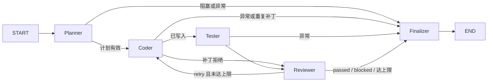

# V2：可信隔离副本上的自动修复闭环

V2 新增独立 `graph` 包和 CLI。旧 `agent/code_agent.py` 仍是只读问答 Agent，
`ask()`、工具输出、Middleware、Token 日志及 `main.py` 均保持原样。
本阶段不包含 MCP、Git worktree、Docker、Web 或持久化审批。

## 复用与环境

Planner 通过 V1 `CodeSearchService.get_repository_summary(max_files=100)` 获取清单，
已配置索引时调用 `search_code(top_k=3)`；使用 `get_code_context` 获取当前磁盘证据，
对最多三个可编辑文件、需求中最多两个英文标识符调用 `find_symbol`。
Coder 每轮重新调用 `get_code_context`，成功写入后调用 `sync_changed_files`。
原有 AST-first、Hash/signature/manifest、BM25/RRF/Rerank 算法未复制或替换。
同步异常保留源码，标记 `index_dirty` 并阻塞交付，不声称索引一致。

不配置 Manager 的 V1 服务可以读取源码，但写入后的同步会失败；完整修复应注入同仓库服务。
离线 demo 用 `DemoStore` 模拟向量后端，用真实 `VectorStoreManager` 增量协议同步，
不执行真实 Embedding 或语义检索。在线 CLI 使用每次新建的临时 Chroma 目录和唯一 Collection，
不会复用开发仓库的默认索引。

本次验证环境：Python 3.13.15、LangGraph 1.2.15、LangChain 1.4.6、
langchain-core 1.6.11、Pydantic 2.14.1、pytest 9.0.3。无需新增依赖。
采用官方 [StateGraph](https://reference.langchain.com/python/langgraph/graph/state/StateGraph)
及 [条件边](https://reference.langchain.com/python/langgraph/graph/state/StateGraph/add_conditional_edges)，
模型通过 `with_structured_output(..., method="function_calling")` 输出 Pydantic 数据。

## Graph 和状态



`AgentState` 为 TypedDict，字段采用覆盖语义，没有消息累加 Reducer。
输入为 `task_id/user_request/workspace_root`；证据为 `repo_summary/retrieved_context`；
决策为 `plan/review_result`；执行为 `changes/test_result/test_history`；
控制为 `iteration/max_iterations/status/patch_error/index_dirty/patch_fingerprints`；
产出为 `token_usage/final_report`。State 不保存完整仓库或无限日志。

- Planner 只读，无 Shell；生成计划或明确阻塞。空计划、重复目标、未知文件、越权目标均拒绝。
- Coder 读取最新文本及原始字节哈希，生成结构化替换块，由确定性 Editor 执行。
- Tester 不调用模型。只有固定白名单内的 pytest，结果来自退出码及 JUnit 实际测试数。
- Reviewer 先执行硬规则：补丁冲突/测试断言失败只能重试；环境、超时、取消、无有效测试、
  未应用修改、索引不一致阻塞；通过硬规则后才调用模型审查需求、计划、Diff、变更及测试。
- Finalizer 统一生成内存报告、`changes.diff` 和 `report.json`。

`iteration` 表示已进入 Coder 的次数，包括补丁被拒绝的轮次。默认三次，硬上限五次。
`retry` 且未达上限才继续；耗尽轮数为 `failed`，环境/权限/工具问题为 `blocked`，
可见验收和模型审查均通过为 `success`。相同补丁指纹重复出现会提前阻塞。
模型每节点仅调用一次，结构化解析失败直接终止；在线 SDK 本身最多重试一次请求。
所有四个业务节点的异常和 KeyboardInterrupt 转统一阻塞出口。实例只能运行一次，
没有跨重启恢复、Checkpointer 或 Interrupt。

## 编辑边界

CLI 在线模式要求 `--workspace` 和 `--trusted-copy`。声明表示调用者已确认这是可信本地副本，
V2 无法从目录内容证明其来源。应先人工准备副本，不能把未知仓库改名后视为可信。
拒绝开发仓库、开发仓库的父目录和子目录、用户主目录、盘根、常见系统目录、隐藏目录、
符号链接及 Windows 目录联接；路径每一级均检查。目录属性无法读取时采取拒绝策略。

只支持已有业务 `.py` 文件，拒绝绝对路径、`..`、冒号/备用数据流、敏感文件、
测试目录/测试文件、`conftest.py`、`setup.py`、`config.py`、`settings.py`、硬链接等。
不支持创建、删除、重命名文件或修改依赖。LLM 不能扩大白名单。

每文件最大 64 KiB、最多 1000 行，计划/任务最多八个文件。Planner 清单最多 100 个文件，
证据文本有界；模型 payload 最多 24000 字符，超限阻塞而非截断待编辑全文。
每轮每文件只允许一个唯一匹配替换块；多个替换可在唯一较大代码块内表达。
验证原始字节 SHA256、唯一匹配、声明编码、Python 语法及替换后大小，拒绝无变化补丁。
保留声明编码和常见 CRLF 换行。

整批验证后先写临时文件，每文件用 `os.replace` 提交；失败尝试恢复本轮已经写入的文件。
**多个文件不是操作系统事务**：断电、进程强制终止或恢复写入失败仍可能留下部分修改。
报告根据任务基线重新读取净变更，尽量保留残留修改的 Diff。
可信副本应由当前进程独占；路径和哈希复查不能消除恶意外部并发造成的全部竞争窗口。
失败后不会自动恢复任务起点，已成功应用的修复留在副本中供审查。

## pytest 边界与结果

执行 `sys.executable -m pytest <白名单> -q`，`shell=False`；模型不能传入命令或 pytest 选项。
白名单为已有 `tests/test` 目录或 `test_*.py` 文件，每轮复核目标及子树链接。
禁用插件自动发现，清除继承的 `PYTEST_ADDOPTS/PYTEST_PLUGINS/PYTHONPATH`，
覆盖 addopts；这可能使依赖外部 pytest 插件的演示项目无法直接运行。
固定测试依赖仍需预先安装，V2 不自动安装包。

默认超时 30 秒，最大 300 秒。stdout/stderr 合并持续排空，默认最多保留 16 KiB，
最多 64 KiB，超出丢弃并标记 truncated，不把完整输出保存在内存或额外日志文件。
JUnit 使用每次新建的临时目录，解析大小上限 4 MiB，任务结束后清理；
最终报告保留测试命令和有限日志，因此其中的 JUnit/cache 临时路径不再存在。
日志和报告对已知凭据环境值及常见敏感赋值脱敏，不能保证识别任意业务隐私文本。

结果分为 `passed/failed/no_tests/timeout/environment/cancelled`。
只有退出码零、至少一个实际通过测试、无失败或错误，才算测试通过；全部跳过/xfail 不能算成功。
导入失败属于环境错误（JUnit 会记录一个 error，汇总到 failed 数）；缺少 pytest 和启动异常均阻塞。
Windows 超时/取消用固定 `taskkill /PID ... /T /F` 尽力清理进程树，POSIX 终止独立进程组。
无法保证清理脱离进程树的子孙进程；输出管道的后台排空线程只有限等待。
**本地 subprocess 不是沙箱**，测试及 conftest 仍具有当前用户权限；仅运行已审查的可信 demo。

## CLI 演示与人工验证

以下命令的 `python` 应替换为 PyCharm 配置解释器。本次为：
`C:\Users\wzw41\develop\miniconda\envs\langgraph\python.exe`。

```powershell
python -m graph.cli --demo success
python -m graph.cli --demo retry
python -m graph.cli --demo limit
```

每次均在系统临时目录创建新的固定 calculator 副本；模型和向量存储为模拟，
编辑、V1 增量同步及 pytest 为真实执行。success 一轮成功；retry 首轮生成错误算式，
pytest 失败反馈后第二轮成功；limit 三轮失败后返回 failed，CLI 退出码为 1。
success 返回 0，blocked 返回 2。控制台打印节点进入/退出、每轮测试摘要、最终 Diff 和报告路径。
用文本编辑器查看 `changes.diff`，确认仅将 `return a - b` 修改为 `return a + b`；
查看 `report.json` 中的实际通过数、轮数、index_dirty 与 token_usage。
模拟模型没有 Token 用量，报告为 null，不能据此估算真实成本。

真实模型模式（会产生模型/Embedding/Rerank 用量，本次未执行）：

```powershell
# 在进程环境中预先配置 DASHSCOPE_API_KEY；不把凭据写进命令或报告。
python -m graph.cli --online --workspace C:\trusted-demo-copy --trusted-copy --request "修复 add 加法" --tests tests
```

模型配置沿用 `config.LLM_MODEL/LLM_BASE_URL/MAX_TOKENS`。V2 模型从进程环境取得 Key；
向量索引初始化沿用 V1 Manager 的既有配置加载机制。CLI 不显示凭据和 SDK 原始异常。
真实服务供应商的结构化输出、Embedding/Rerank、实际 Token 回调尚需受控在线人工验证。
报告和副本保留在临时目录供审查，系统可能定期清理；需要留存时人工复制到安全位置。

常见排查：blocked 时先检查报告的错误类型/阶段、工作区权限、是否绑定相同仓库的服务、
文件/提示词上限和固定测试依赖。`index_dirty` 应人工恢复索引后重新创建任务；
不要通过跳过同步或放宽 Reviewer 规则把阻塞改成成功。

## 测试与当前验证

```powershell
python -m pytest tests/test_v2_editor.py tests/test_v2_test_runner.py tests/test_v2_workflow.py tests/test_v2_integration.py -q --tb=short -p no:cacheprovider
python -m pytest tests -q --tb=short -p no:cacheprovider
```

测试不调用真实模型、Embedding 或 Rerank，不要求真实 Chroma 服务启动。
真实文件写入、V1 内存索引同步、pytest 子进程、一次成功、失败重试、上限退出、
结构错误、索引异常、超时、无测试、全部跳过、输出上限、半途提交/回滚失败均有覆盖。
符号链接权限不足时真实链接用例明确跳过，同时通过不依赖权限的链接检测测试。
旧 V1 服务及 CodeAgent 回归一并运行，原测试未修改。

本次首个基线命令 `python -m pytest tests -q` 遇到沙箱系统 Temp 权限限制：
93 passed、35 errors；换用可写 basetemp 后基线 127 passed、1 skipped。
V2 路径安全检查还需读取祖先目录属性，沙箱内被拒绝，因此最终离线回归及演示在授权的沙箱外运行。
完整结果与实际命令在最终交付中报告；不能把权限失败计为通过。

## V3 替换点（仅设计说明）

未来可将 Editor 的文件操作换成 MCP File 工具，检索适配为 MCP Search，
将可信副本准备换成 Git worktree，将 PytestRunner 换成受限 Docker Execution。
仍需保留路径权限、版本冲突检查、确定性验收和结构化错误；本次没有实现这些组件。
